# TP1 — Sécuriser un dépôt Python avec les hooks pre-commit

Arthaud Proust — Projet fil rouge NOVA SERVICES

Environnement : macOS, Python 3.15.2, pre-commit 4.7.0, Bandit 1.9.4, detect-secrets 1.5.0, pytest 9.2.0, pip-audit 2.10.1. Les versions sont épinglées dans `requirements-dev.txt` et `.pre-commit-config.yaml`, et la CI utilise la même version de Python.

## 1. Analyse du code initial

Le `app.py` de départ pose des problèmes de qualité et de sécurité. Côté qualité, `import os` n'est pas utilisé, la variable `password` est déclarée sans être utilisée et la fonction mélange saisie, calcul et affichage, ce qui la rend impossible à tester sans interaction.

Côté sécurité, il y a deux problèmes plus graves. `eval(user_input)` exécute comme du code Python tout ce que l'utilisateur saisit : `__import__('os').system('rm -rf ~')` s'exécute avec les droits du processus. Une entrée non fiable devient donc une exécution de code arbitraire. Le mot de passe en dur, lui, se retrouve dans l'historique Git, sur chaque clone, dans chaque fork et dans les sauvegardes. Le supprimer dans un commit suivant ne l'efface pas de l'historique, et le changer oblige à redéployer le code.

La correction consiste à lire le secret depuis l'environnement et à remplacer `eval()` par une liste blanche d'opérations. C'est ce qui a été appliqué en section 4.

## 2. Mise en place de pre-commit

La configuration demandée ([.pre-commit-config.yaml](.pre-commit-config.yaml)) est versionnée à la racine. Le premier `pre-commit run --all-files` a soulevé deux points imprévus.

Le premier : `detect-secrets scan` ne parcourt que les fichiers suivis par Git. Lancé avant le premier `git add`, il produit un baseline vide. Une fois les fichiers indexés, le scan trouve bien le mot de passe :

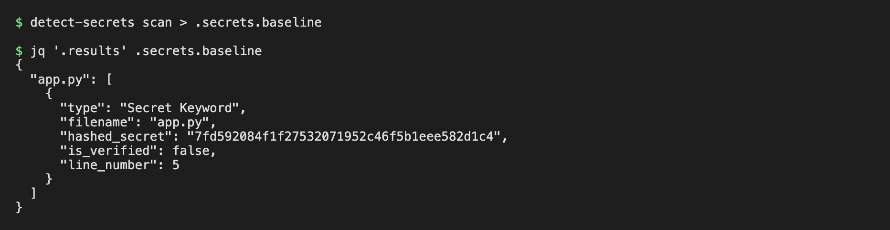

Si l'on garde ce baseline tel quel, le secret devient « connu » et le hook ne le signale plus. La capture du commit bloqué (plus bas) le montre : `Detect secrets` passe alors que le mot de passe est toujours dans le code. C'est exactement l'usage du baseline que le sujet déconseille. Le baseline a donc été régénéré après la correction, et il est vide.

Le second, plus grave : avec la version de Bandit proposée dans le sujet (1.8.6), le hook affichait `Passed` alors que `eval()` était présent. Le mode verbeux montre que Bandit plante sur Python 3.15, ignore le fichier et renvoie quand même un code de succès :

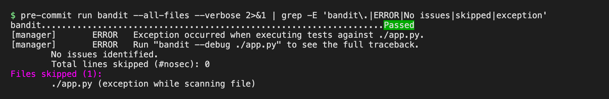

Un outil de sécurité qui échoue en silence est pire qu'aucun outil, car il donne une fausse assurance. Passer à Bandit 1.9.4 corrige le problème. La leçon à retenir : vérifier qu'un contrôle détecte réellement un cas connu avant de lui faire confiance, et surveiller les fichiers « skipped » dans ses rapports.

Une fois Bandit mis à jour, le commit est bloqué :

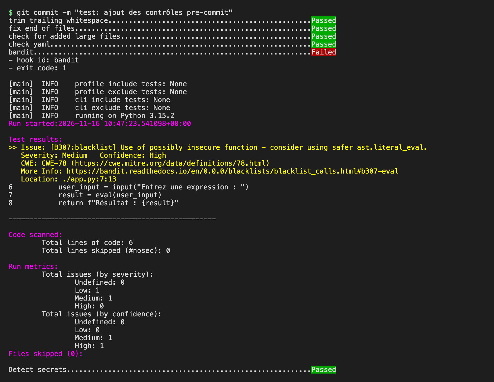

L'historique Git suit les commits demandés par le sujet. Le commit `test: ajout des contrôles pre-commit` ne contient que la configuration, le baseline et le `.gitignore` : la version imparfaite de `app.py` a été refusée par les hooks et n'est donc jamais entrée dans le dépôt, ce qui est précisément le résultat recherché. Le commit `test: correction des contrôles` apporte le code corrigé (section 4), `security: ajout des contrôles pre-commit` ajoute les tests, les dépendances et les hooks `pytest` et `pip-audit`, puis viennent la CI et ce rapport.

On note aussi que Bandit compte une alerte `Low`, le mot de passe en dur (B105), qui n'apparaît pas à cause de l'option `-ll`. Ce filtre réduit le bruit, mais il laisse de côté une partie des alertes : c'est detect-secrets qui couvre ce cas.

## 3. Scénarios de validation

Le commit d'un fichier contenant des espaces en fin de ligne et un mot de passe en dur échoue deux fois. `trailing-whitespace` corrige le fichier et demande de l'indexer à nouveau, et `detect-secrets` bloque le secret :

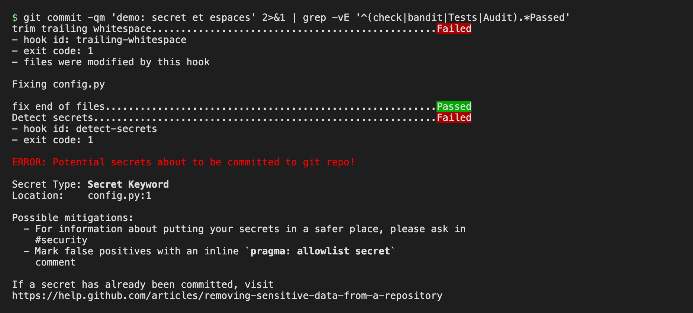

Un test volontairement faux bloque le commit grâce au hook `pytest` :

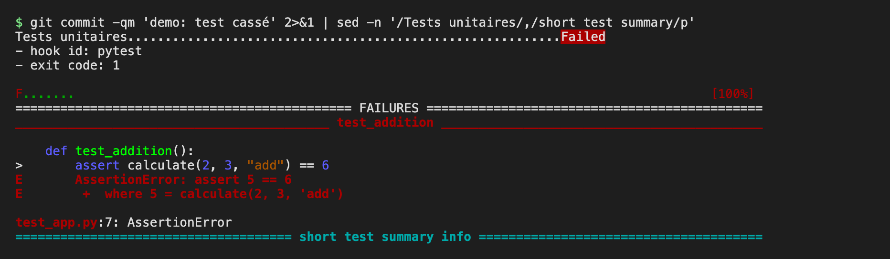

L'ajout de `requests==2.25.0` dans `requirements.txt` est refusé par `pip-audit`, qui trouve 24 vulnérabilités, dont certaines dans les dépendances transitives `urllib3` et `idna` :

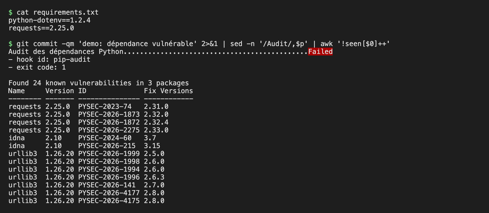

Prenons l'exemple de PYSEC-2023-74 (CVE-2023-32681) : `requests` 2.25.0 transmet l'en-tête `Proxy-Authorization` lors d'une redirection HTTPS, ce qui peut faire fuiter les identifiants du proxy vers le serveur cible. La version 2.31.0 corrige cette faille. Pour NOVA SERVICES, l'impact dépend de l'utilisation d'un proxy authentifié pour les appels sortants. Quoi qu'il en soit, l'action est simple : monter `requests` à la dernière version corrigée (2.33.0 couvre toutes les alertes listées) et épingler aussi les dépendances transitives. Ce cas montre que `pip-audit -r` résout lui-même les versions des dépendances non épinglées, et qu'un fichier de verrouillage complet donne donc un résultat plus fidèle.

Une fois tout corrigé, l'ensemble des contrôles passe et le commit est accepté :

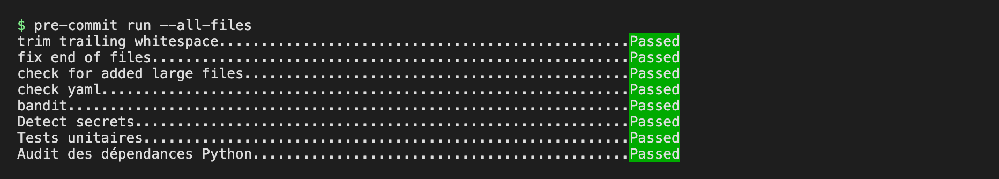

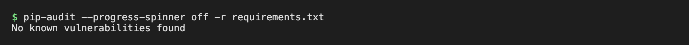

## 4. Corrections apportées

Le secret est lu dans `APP_PASSWORD` via `python-dotenv`. Le fichier `.env` est exclu par `.gitignore`, et `.env.example` documente la variable sans lui donner de valeur. `get_password()` lève une erreur si la variable est absente, plutôt que de continuer avec une valeur vide, et n'affiche jamais le secret.

`eval()` est remplacé par `calculate(a, b, operation)`, qui n'accepte que quatre opérations nommées et rejette tout le reste. L'entrée utilisateur ne peut plus que sélectionner un comportement prévu, jamais injecter du code. La division par zéro est traitée explicitement.

Huit tests unitaires ([test_app.py](test_app.py)) couvrent les quatre opérations, la division par zéro, l'opération inconnue, ainsi que la présence et l'absence de la variable d'environnement. Les valeurs factices des tests portent un `pragma: allowlist secret` sur la ligne même, ce qui rend l'exception visible en revue, contrairement à une entrée dans le baseline.

`pytest` et `pip-audit` sont ajoutés comme hooks locaux en `language: system`. Ils doivent voir les dépendances du projet, ce que ne permettrait pas l'environnement isolé que pre-commit crée pour les autres hooks. En contrepartie, le venv doit être actif au moment du commit, ce que précise le [README](README.md).

## 5. Contrôles en CI et protection de `main`

Un hook local se contourne en une ligne. Le commit ci-dessous ajoute un `eval()` sans qu'aucun hook ne s'exécute :

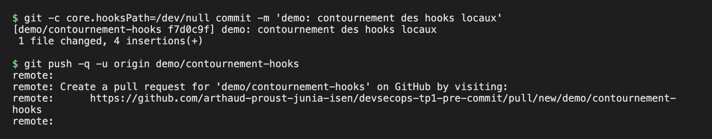

Le workflow [ci.yml](.github/workflows/ci.yml) rejoue `pre-commit run --all-files` sur chaque push et chaque pull request, après avoir installé `requirements-dev.txt`. Les actions sont épinglées par SHA, car un tag peut être déplacé alors qu'un commit est immuable. Le jeton du workflow est limité à la lecture. Sur la [pull request de démonstration](https://github.com/arthaud-proust-junia-isen/devsecops-tp1-pre-commit/pull/1), laissée ouverte comme preuve, la CI échoue sur Bandit :

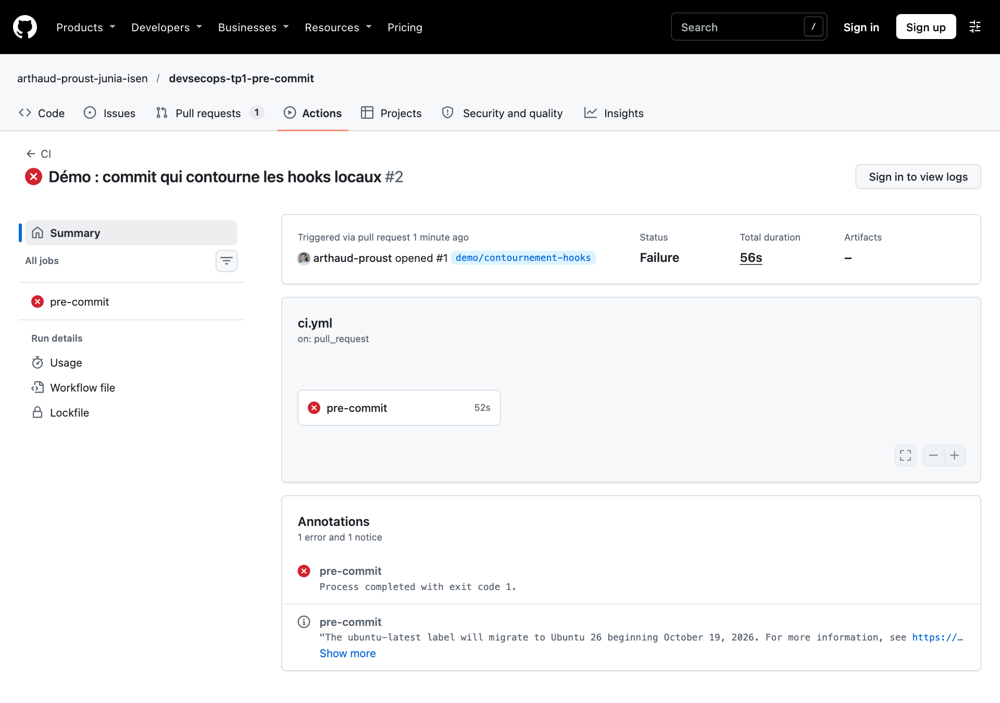

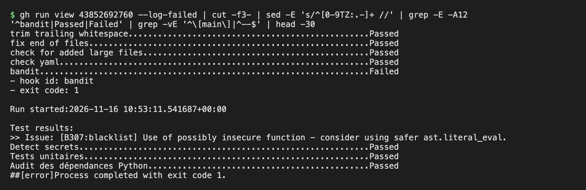

Pour que cet échec bloque réellement l'intégration, `main` est protégée côté GitHub : pull request obligatoire, check `pre-commit` requis sur une branche à jour, règle appliquée aussi aux administrateurs, force-push et suppression interdits. Un push direct est refusé par le serveur :

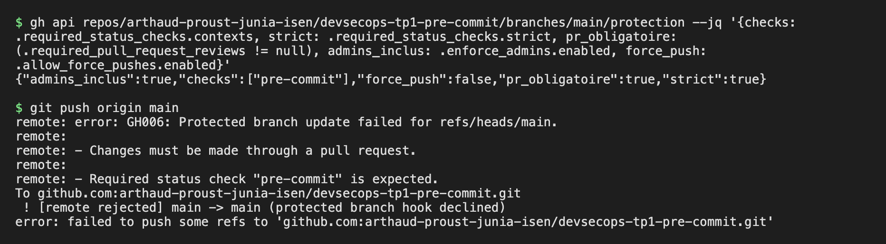

Le nombre d'approbations requises est fixé à zéro parce que je travaille seul sur ce dépôt. Pour une équipe, il faudrait au moins une revue. pre-commit.ci n'a pas été activé : il aurait fait doublon avec le workflow, et son intérêt principal (les correctifs automatiques et la mise à jour des versions de hooks) relève d'une décision d'équipe.

## 6. Adaptation à NOVA SERVICES

Les contrôles génériques (espaces, fin de fichier, YAML, gros fichiers) et detect-secrets doivent être communs à tous les dépôts : un secret fuit aussi bien depuis un script shell que depuis une API Python. Bandit, pytest et pip-audit sont propres à Python et s'appliquent à l'API, à l'outil d'administration et aux scripts écrits en Python.

En local, je bloquerais sur tout ce qui est rapide et déterministe : formatage, secrets, Bandit et tests unitaires rapides. pip-audit dépend d'un service externe et d'une base qui évolue indépendamment du code : il peut faire échouer un commit qui n'a rien changé, ou bloquer un développeur hors ligne. Je le placerais en CI, où il est bloquant sur les pull requests, avec en plus une exécution planifiée quotidienne pour détecter les nouvelles CVE sur du code qui ne bouge pas. Les suites de tests longues et les analyses plus lourdes (conteneurs, SAST complet) vont aussi en CI.

Pour éviter qu'une exception à detect-secrets masque un vrai secret, toute modification de `.secrets.baseline` doit passer par une revue de l'équipe sécurité, via un fichier `CODEOWNERS`. Les exceptions sont mises en ligne par `pragma: allowlist secret`, avec une justification dans le message de commit, et `detect-secrets audit` est relancé régulièrement sur le baseline.

La mise à jour des versions de hooks revient à l'équipe plateforme ou DevSecOps, qui lance `pre-commit autoupdate` (ou fait confiance à Renovate ou Dependabot) dans une pull request dédiée. La CI valide alors que les nouvelles versions détectent toujours les cas connus. L'épisode Bandit 1.8.6 montre que ce n'est pas acquis.

La preuve qu'une vulnérabilité est corrigée se compose de trois éléments : la pull request qui la corrige, un test de non-régression qui échouait avant et passe après, et un run CI vert qui inclut le contrôle à l'origine de l'alerte. Le ticket de suivi relie les trois.

Quand aucun correctif n'existe pour une dépendance vulnérable, il faut d'abord évaluer si le code vulnérable est réellement atteignable dans notre usage. On peut ensuite atténuer le risque (désactiver la fonctionnalité, filtrer les entrées, isoler le composant) ou remplacer la bibliothèque. Si le risque est accepté, l'exception passe par `pip-audit --ignore-vuln <ID>`, avec une justification, un responsable et une date de réexamen.

## 7. Politique de sécurisation du code

Tout dépôt de NOVA SERVICES versionne un `.pre-commit-config.yaml` qui inclut au minimum les contrôles génériques et detect-secrets. Les dépôts Python y ajoutent Bandit et les tests unitaires rapides. Chaque développeur installe les hooks à l'arrivée sur le projet, en suivant le README.

La CI rejoue l'intégralité des hooks, et y ajoute pip-audit et les tests complets. Elle tourne sur chaque pull request et une fois par jour sur la branche principale. La branche principale est protégée : pull request, CI verte et une approbation sont obligatoires, et les administrateurs n'en sont pas dispensés.

Un contrôle bloquant en échec empêche le merge, sans exception automatique. Un faux positif est qualifié par le développeur, puis neutralisé de la façon la plus étroite possible (pragma sur la ligne, `# nosec Bxxx` avec le code de la règle, `--ignore-vuln` avec l'identifiant), avec une justification écrite dans la pull request. Toute exception, y compris une modification du baseline, est validée par le référent sécurité de l'équipe. Une exception sur une vulnérabilité de dépendance porte une date d'expiration de 90 jours au plus.

Les versions des outils sont épinglées. L'équipe DevSecOps les met à jour chaque mois dans une pull request dédiée, et vérifie sur un échantillon connu que chaque outil détecte encore ce qu'il doit détecter.

## 8. Indicateurs de suivi

Un tableau s'impose ici, car chaque indicateur a cinq attributs.

| Indicateur | Source | Propriétaire | Fréquence | Seuil et action |
|---|---|---|---|---|
| Taux de dépôts conformes (config pre-commit présente et CI qui l'exécute) | API GitHub de l'organisation | Équipe DevSecOps | Mensuelle | Sous 90 % : relance des équipes concernées et accompagnement à l'installation |
| Vulnérabilités de dépendances ouvertes, par sévérité | Exécutions planifiées de pip-audit | Lead dev de chaque dépôt | Hebdomadaire | Toute critique ouverte depuis plus de 7 jours : escalade au responsable sécurité |
| Exceptions actives (pragmas, `nosec`, `--ignore-vuln`, entrées de baseline) | Recherche dans le code et dans le baseline | Référent sécurité | Mensuelle | Exception expirée ou hausse de plus de 20 % : revue de toutes les exceptions du dépôt |

Le nombre d'exceptions est à mon avis le plus révélateur. S'il augmente, cela veut souvent dire que les contrôles sont contournés au lieu d'être respectés, alors que les autres indicateurs continuent d'afficher de bons résultats.

## 9. Questions de compréhension

**Hook pre-commit.** C'est un script que Git exécute avant de créer un commit. S'il échoue, le commit est annulé. Le framework pre-commit permet de déclarer ces scripts dans un fichier versionné, au lieu de les copier à la main dans `.git/hooks`.

**Contrôle local ou contrôle CI.** Le contrôle local donne un retour immédiat au développeur, mais il dépend de son poste et se contourne facilement. Le contrôle CI tourne dans un environnement maîtrisé, et ne peut pas être contourné si la branche est protégée.

**Versionner `.pre-commit-config.yaml`.** Toute l'équipe et la CI appliquent ainsi exactement les mêmes règles, et chaque modification des contrôles est tracée et relue comme le reste du code.

**Faux positifs de detect-secrets.** L'outil repère des motifs (mot-clé `password` suivi d'une chaîne, entropie élevée). Il ne peut pas savoir si une valeur est un vrai secret ou une valeur d'exemple, un hash ou un identifiant public.

**Baseline et secrets réels.** Un secret ajouté au baseline n'est plus signalé, mais il reste dans le code et dans l'historique, donc exploitable. La seule réponse à un vrai secret est de le révoquer et de le retirer du code. La section 2 montre ce masquage en pratique.

**Risque d'`eval()`.** Il permet l'exécution de code arbitraire avec les droits de l'application : lecture de fichiers, exfiltration de secrets, commandes système.

**Exclure `.env`.** Ce fichier contient les vraies valeurs locales. Une fois commité, il se retrouve dans tous les clones et dans l'historique, de façon durable.

**Variable d'environnement insuffisante.** La valeur reste en clair dans le fichier `.env`, elle est lisible par les processus enfants, visible dans `/proc` ou dans les dumps, et elle n'a ni rotation, ni contrôle d'accès, ni journal d'accès. Un gestionnaire de secrets apporte ces trois garanties.

**Analyse de code ou audit de dépendances.** L'analyse de code (Bandit) examine notre propre code à la recherche de pratiques dangereuses. L'audit (pip-audit) compare les versions des bibliothèques tierces à une base de vulnérabilités connues. Aucun des deux ne couvre le périmètre de l'autre.

**Tests en CI malgré le hook.** Le hook peut ne pas être installé, être contourné, ou s'exécuter dans un environnement local différent de la cible. La CI est la seule exécution garantie et reproductible.

**Empêcher les pushes directs sur `main`.** Uniquement côté serveur, avec une règle de protection de branche qui exige une pull request et des checks verts, et qui s'applique aussi aux administrateurs. La section 5 le montre.

**Indicateurs.** Ceux de la section 8 : la couverture des dépôts, les vulnérabilités ouvertes et le délai de correction, et le nombre d'exceptions actives.

## 10. Limites

Ces contrôles ne garantissent pas l'absence de vulnérabilités. Bandit ne voit que des motifs connus dans le code Python, detect-secrets ne trouve que les secrets qui ressemblent à des secrets, et pip-audit ne connaît que les vulnérabilités déjà publiées. Le cas de Bandit 1.8.6 montre en plus qu'un outil peut se tromper sur lui-même. La revue de code, les tests de sécurité et la gestion des secrets en production restent indispensables.
